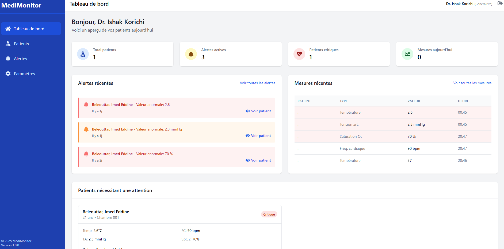
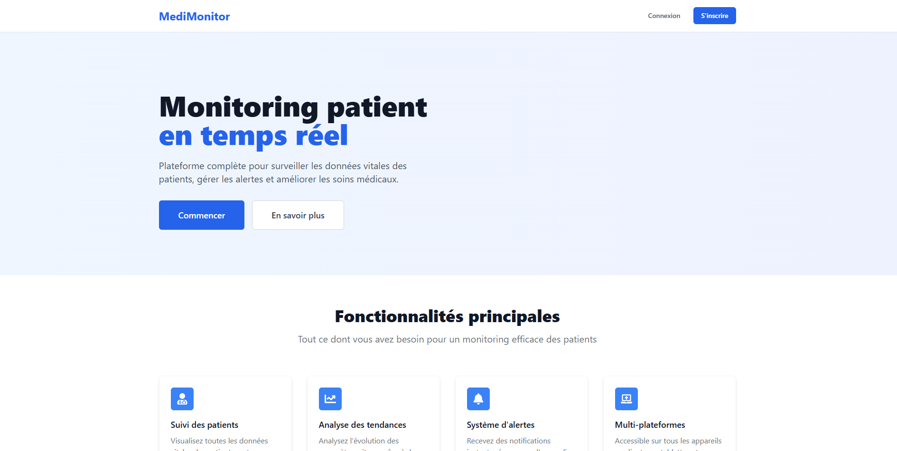
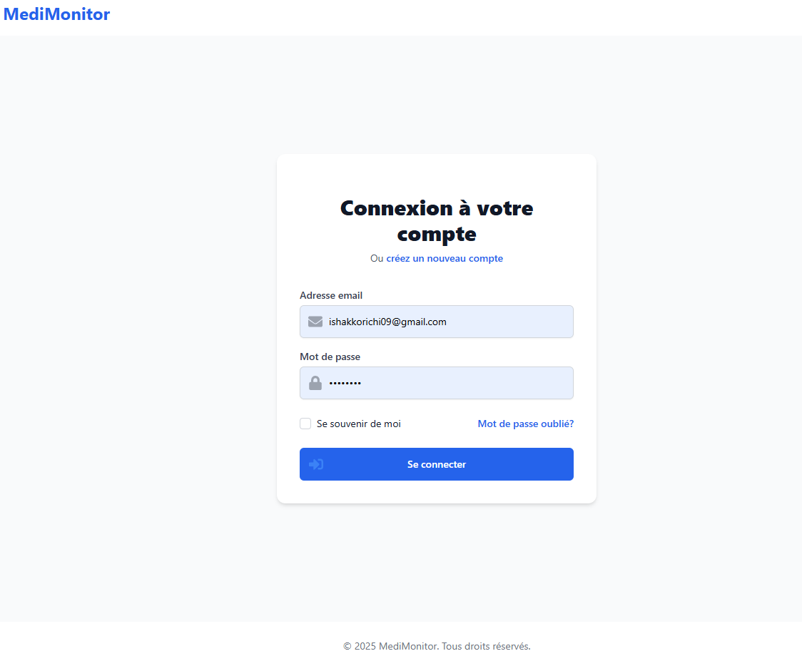
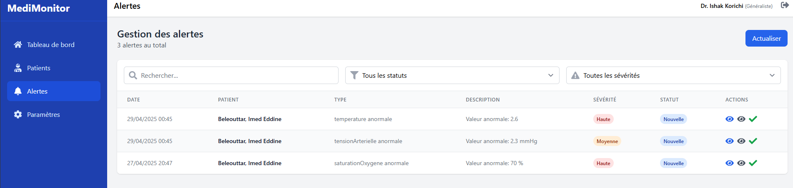

# MediMonitor — suivi des constantes vitales

Application web de suivi de patients : les soignants voient les constantes vitales de chaque patient, reçoivent des alertes quand une valeur sort des limites et suivent l'évolution dans le temps.



## Ce qu'il contient

- Tableau de bord avec rafraîchissement automatique des mesures
- Dossiers patients : création, modification, historique des mesures
- Mesures : température, fréquence cardiaque, saturation en oxygène, tension artérielle, fréquence respiratoire, glycémie
- Rôles : médecin, infirmier, administrateur
- Alertes classées par gravité (basse, moyenne, haute, critique) avec un statut (nouvelle, vue, résolue)
- Graphiques d'évolution
- Inscription et connexion avec JWT

## Stack

Next.js 13 (Pages Router) · React · Tailwind CSS · Recharts · MongoDB (Mongoose) · JWT · bcrypt

## Lancer en local

```bash
npm install
npm run dev        # http://localhost:3000
```

Variables d'environnement (`.env.local`) :

```bash
MONGODB_URI=
JWT_SECRET=
```

## API

| Route | Rôle |
|---|---|
| `/api/auth/register`, `/api/auth/login` | Inscription, connexion |
| `/api/patients`, `/api/patients/[id]` | Patients |
| `/api/measurements` | Mesures |
| `/api/alerts`, `/api/alerts/[id]` | Alertes |

## Captures

| Accueil | Connexion | Alertes |
|---|---|---|
|  |  |  |

---

Réalisé par **Ishak Korichi** · [korichi-ishak.vercel.app](https://korichi-ishak.vercel.app)
